## Sobre mim

Estudo Ciência da Computação na Universidade Federal de Alfenas (UNIFAL-MG). Meu foco é unir tecnologia e criatividade: interfaces bem cuidadas no front-end e jogos com identidade visual forte.

Fora do código: Critical Role toda semana (Mighty Nein no coração, com Essek, Caleb e Jester de favoritos), leitura e RPG de mesa, jogando, mestrando ou criando sistemas.

## Em desenvolvimento

### The Guardian Nymph · Unity 6 · C#

Jogo de simulação e defesa de vilarejo inspirado no modo de construção de *ActRaiser*, ambientado na mitologia grega. Projeto em equipe da disciplina de Computação Gráfica.

- Uma ninfa guardiã orienta a construção do vilarejo, enquanto os aldeões trabalham e rezam para gerar fé
- Magias desenhadas com o mouse (Zeus, Poseidon, Atena), com reconhecimento de formas feito do zero, contra ondas de criaturas mitológicas
- Templos dos deuses oferecem bênçãos que mudam a partida, no estilo de *Hades*
- Modelos e animações feitos no Blender pelo grupo, com exportação automatizada para o Unity

Repositório privado durante o desenvolvimento.

## Projetos

| Projeto | Sobre |
| --- | --- |
| **Dungeons and Newbies** | Projeto Integrador do ensino médio, refeito do zero em 2026: guia interativo de D&D para iniciantes, com rolador de dados, simulador de testes, quizzes com ranking e mural do Mestre. Node.js, Express e MySQL. |
| **AgroPay** | Sistema criado para a feira de ciências do IF que automatiza o pagamento de trabalhadores rurais, com cálculos e relatórios. |

## Tecnologias

## Formação

**Bacharelado em Ciência da Computação** · Universidade Federal de Alfenas (UNIFAL-MG) · 2025 – atual

---

